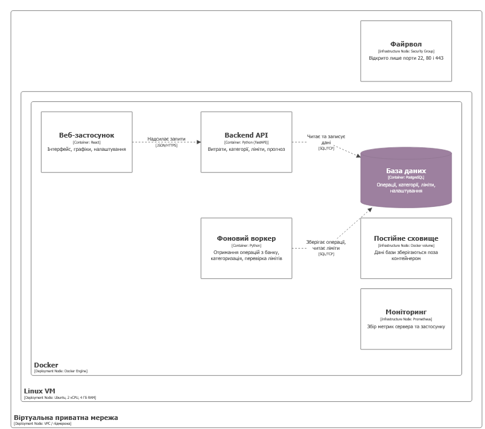

# FinWise

Вебсистема для обліку особистих фінансів: отримання банківських операцій, автоматична категоризація витрат, ліміти по категоріях зі сповіщеннями, статистика та прогноз залишку коштів.


## 1. Бізнес-ідея

FinWise допомагає користувачеві зрозуміти, куди йдуть його гроші. Користувач надає системі доступ до своїх банківських операцій, а вона сама розподіляє їх за категоріями, показує діаграми витрат і розраховує, скільки коштів залишиться наприкінці місяця. На початку користування потрібно вказати місячний дохід і, за бажанням, встановити ліміти по категоріях. Якщо витрати наближаються до ліміту або перевищують його, система надсилає сповіщення. Користувач також може виправляти категорії та вносити витрати готівкою вручну.

Архітектуру спроєктовано як для реальної системи: дані надходять із банку через банківський API за згодою користувача. Під час навчання замість реального банку використовується CSV-виписка, яка підключається через той самий адаптер.

## 2. Функціональні вимоги (User Stories)

1. Як користувач, я хочу підключити свій банківський рахунок за своєю згодою, щоб система сама отримувала мої операції.
2. Як користувач, я хочу вказати свій місячний дохід під час початкового налаштування, щоб система розуміла мій бюджет.
3. Як користувач, я хочу, щоб операції автоматично розподілялися за категоріями (продукти, кафе, розваги тощо).
4. Як користувач, я хочу змінити категорію операції, якщо система помилилася.
5. Як користувач, я хочу додати витрату готівкою вручну в обрану категорію або в категорію «Інші витрати».
6. Як користувач, я хочу бачити діаграми витрат за категоріями та періодами.
7. Як користувач, я хочу бачити, скільки коштів залишиться наприкінці місяця.
8. Як користувач, я хочу встановити місячний ліміт для кожної категорії.
9. Як користувач, я хочу отримувати сповіщення, коли наближаюся до ліміту або перевищую його.
10. Як користувач, я хочу, щоб переказ між моїми рахунками не рахувався як витрата.
11. Як користувач, я хочу в будь-який момент відкликати доступ до своїх банківських даних.

## 3. Нефункціональні вимоги

- **Безпека.** Дані між користувачем і сервером передаються по HTTPS. Паролі й ключі не пишуться в код, а передаються окремо через змінні оточення. Токени доступу до банку зберігаються в зашифрованому вигляді. До бази даних не можна підключитися ззовні. Користувач може будь-коли відкликати доступ до свого банку.
- **Доступність.** Не менше 99% часу на місяць. Якщо контейнер упаде, він запускається знову приблизно за 2 хвилини, а дані не пропадають після перезапуску.
- **Продуктивність.** 95% запитів до API обробляються швидше ніж за 500 мс.
- **Масштабованість.** Якщо користувачів стане більше, систему має бути легко розширити.
- **Надійність інтеграції.** Нові операції з банку з’являються не пізніше ніж за 15 хвилин. Якщо банк не відповідає, система пробує ще раз пізніше, і нічого не губиться. Сповіщення про ліміт приходить протягом 5 хвилин після появи операції.
- **Observability.** Метрики збираються кожні 15 секунд, логи контейнерів зберігаються в одному місці, а якщо щось ламається, система надсилає сповіщення протягом 5 хвилин.
- **Зручність використання.** Інтерфейс нормально виглядає на екранах від 360 px, а сайт можна встановити як застосунок (PWA).

## 4. Методологія та DevOps

Обрано Scrum зі спринтами по одному-два тижні. Користувацькі історії складають backlog продукту, а на початку кожного спринту з нього обирається набір історій для виконання. DevOps-практики вбудовуються в кожен спринт:

1. увесь код, інфраструктура та архітектурна документація зберігаються в Git;
2. кожна зміна проходить автоматичну збірку та перевірку (CI);
3. застосунок упаковується в Docker-образи;
4. перевірений образ автоматично розгортається на сервері (CD);
5. інфраструктура описується кодом;
6. стан системи відстежується за допомогою метрик і логів.

## 5. Технологічний стек

| Шар | Технологія |
|---|---|
| Frontend | React |
| Backend API та воркер | Python (FastAPI) |
| База даних | PostgreSQL |
| Інфраструктура | Docker, Prometheus |

## 6. Архітектура

Архітектура описана як код у форматі Structurizr DSL: [`docs/architecture/workspace.dsl`](docs/architecture/workspace.dsl). З одного опису будуються три представлення: System Context, Container та Deployment.

### System Context


### Container


### Deployment



## 7. Архітектурні рішення (ADR)

| № | Рішення | Статус |
|---|---|---|
| [0001](docs/adr/0001-modular-monolith.md) | Модульний моноліт із окремим фоновим воркером | Accepted |
| [0002](docs/adr/0002-postgresql.md) | PostgreSQL як основна база даних | Accepted |
| [0003](docs/adr/0003-bank-data-adapter.md) | Адаптер джерела банківських даних (API та CSV) | Accepted |
| [0004](docs/adr/0004-containers-base-images-and-networks.md) | Базові образи та ізоляція мереж у контейнерах | Accepted |

## 8. Структура репозиторію

```
finwise/
├── README.md
├── docs/
│   ├── architecture/
│   │   ├── workspace.dsl
│   │   ├── context.png
│   │   ├── containers.png
│   │   └── deployment.png
│   └── adr/
├── frontend/
└── backend/
```